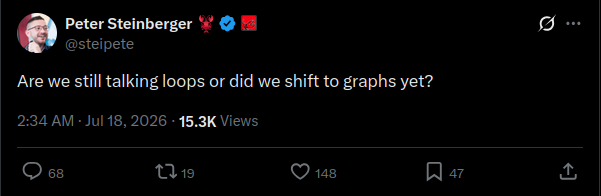
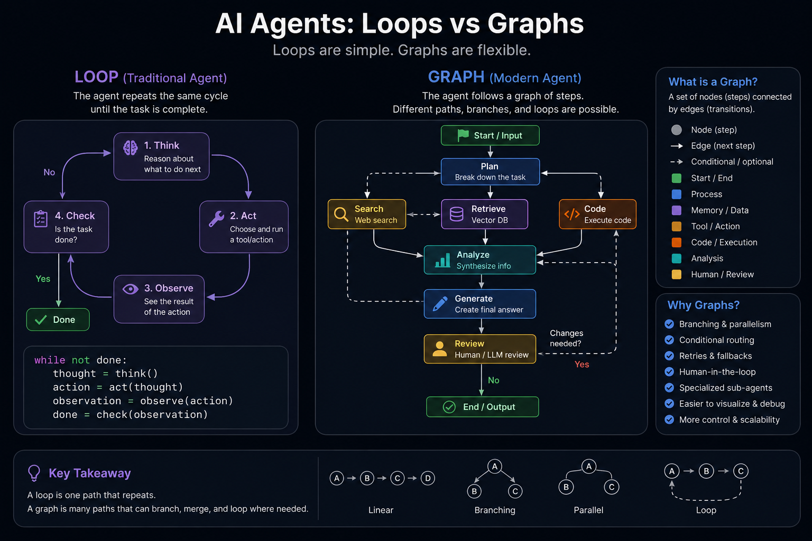

# Athena Graphs

[](LICENSE)
[](plugins/athena-graphs/skills/athena-graphs/SKILL.md)

Give an agent a goal. Athena Graphs turns it into an explicit, durable graph of
specialized agent nodes—branches, joins, review loops, fallbacks, and human
checkpoints included.

No graph DSL or CLI flags in the normal workflow. Install the plugin and talk to
your agent:

> **Use Athena Graphs to implement authentication. Research the existing design
> and threat model in parallel, review the result, and pause before final
> approval.**

> 
>
> [Peter Steinberger (@steipete)](https://x.com/steipete):
> *“Are we still talking loops or did we shift to **graphs** yet?”*

## Install

Athena Graphs bundles one portable `SKILL.md` and one local MCP server. The same
runtime can drive Codex, Claude Code, OpenCode, Aider, Grok Build, model APIs, or
any Agent Skills–compatible host that can connect to MCP.

Prerequisites: Python 3.10+ and [`uv`](https://docs.astral.sh/uv/). No Python
package installation is required; the plugin launcher creates its environment
automatically on first use.

### Codex

```bash
codex plugin marketplace add luckeyfaraday/athena-graphs
codex plugin add athena-graphs@athena-graphs
```

Start a new Codex thread and say:

```text
Use Athena Graphs to build this feature and keep me updated.
```

You can also invoke the skill explicitly with `$athena-graphs`.

### Claude Code

```bash
claude plugin marketplace add luckeyfaraday/athena-graphs
claude plugin install athena-graphs@athena-graphs
```

Start a new session and ask naturally, or invoke:

```text
/athena-graphs:athena-graphs Build the feature and pause before final approval.
```

### Other skill-compatible agents

Install or link this skill directory using your agent's normal Agent Skills
mechanism:

```text
plugins/athena-graphs/skills/athena-graphs/
```

Then register the MCP server from
[`plugins/athena-graphs/.mcp.json`](plugins/athena-graphs/.mcp.json). If the host
does not provide `PLUGIN_ROOT` or `CLAUDE_PLUGIN_ROOT`, use an absolute plugin
path in an equivalent configuration:

```json
{
  "mcpServers": {
    "athena-graphs": {
      "command": "uv",
      "args": [
        "run",
        "--directory",
        "/absolute/path/to/athena-graphs/plugins/athena-graphs",
        "--extra",
        "mcp",
        "agentgraph-mcp"
      ]
    }
  }
}
```

## What using it feels like

The bundled skill handles the mechanics:

1. Inspect the target workspace and infer success criteria.
2. Design the smallest useful graph, or select the default.
3. Start it in the background through MCP.
4. Stream meaningful node progress while continuing the conversation.
5. Ask the user only when a human checkpoint is reached.
6. Resume from the durable checkpoint.
7. Inspect and verify the actual deliverable before reporting success.

The user never has to construct `--goal`, `--criteria`, backend, polling, or
resume commands.

```text
                         ┌─▶ research ──┐
START ─▶ understand ─────┤              ├─▶ review ─┬─▶ END
                         └─▶ build ──────┘           │
                                      ▲              │ changes
                                      └──── revise ◀─┘
```

Loops remain useful; a graph simply makes them one possible route alongside
branching, merging, parallel work, fallback paths, and human review.



## Durable MCP tools

The plugin exposes:

- `graph_start` — validate and start a detached declarative graph.
- `graph_status` — inspect its current node, step, and running state.
- `graph_tail` — stream events and node output previews with a cursor.
- `graph_resume` — merge human answers into a checkpoint and continue.
- `graph_result` — retrieve final state, traces, errors, and diagram.
- `graph_diagram` — render proposed or running graphs as Mermaid.
- `graph_validate` — catch invalid nodes, routes, and joins before starting.
- `graph_list`, `list_backends`, and `doctor` — discovery and diagnostics.

Runs are stored under `~/.athena-graphs/runs` by default, or under
`ATHENA_GRAPHS_HOME` when configured. An MCP request never needs to stay open for
the duration of a coding agent.

## Declarative topology

The skill normally writes this for the user, but the MCP accepts plain JSON:

```json
{
  "name": "research-build-review",
  "max_steps": 12,
  "nodes": [
    {
      "id": "research",
      "kind": "agent",
      "system": "Investigate without editing files.",
      "prompt": "GOAL:\n$goal",
      "output_key": "research"
    },
    {
      "id": "build",
      "kind": "agent",
      "system": "Implement and verify the goal.",
      "prompt": "GOAL:\n$goal\n\nRESEARCH:\n$research",
      "output_key": "work_output"
    },
    {
      "id": "review",
      "kind": "agent",
      "system": "Return JSON with approved, issues, and summary.",
      "prompt": "CRITERIA:\n$success_criteria\n\nWORK:\n$work_output",
      "response": "json",
      "merge": true
    }
  ],
  "edges": [
    {"from": "__start__", "to": "research"},
    {"from": "research", "to": "build"},
    {"from": "build", "to": "review"},
    {"from": "review", "to": "__end__", "when": {"key": "approved", "equals": true}},
    {"from": "review", "to": "build", "when": {"key": "approved", "equals": false}}
  ]
}
```

Supported node kinds are `agent`, `human`, and deterministic `set`. Multiple
outgoing edges fan out; an array in `from` creates an all-source join. Conditions
support equality, existence, truthiness, containment, and nested `all`/`any`/`not`
rules. Parallel state conflicts fail loudly unless the topology declares an
`append`, `sum`, or `merge` reducer.

## Backend compatibility

`backend: auto` uses the caller hint supplied by the skill:

| Caller | Worker backend |
|---|---|
| Codex | `codex exec` |
| Claude Code | `claude -p` |
| OpenCode | `opencode run` |
| Grok | Grok Build CLI |

Explicit backends also include Anthropic and xAI APIs, Aider, and the
dependency-free mock backend. Coding-agent nodes sharing one working directory
run sequentially by default to prevent concurrent file clobbering; non-editing
and API-based branches can execute in parallel.

## Develop locally

Run the complete test suite:

```bash
uv run --directory plugins/athena-graphs --extra dev \
  pytest ../../tests -q
```

Validate both plugin formats and the bundled skill:

```bash
python3 ~/.codex/skills/.system/plugin-creator/scripts/validate_plugin.py \
  plugins/athena-graphs
claude plugin validate .
```

Test directly in Claude Code without installing:

```bash
claude --plugin-dir ./plugins/athena-graphs
```

The Python graph runtime remains available for embedding, debugging, and custom
nodes, but it is intentionally not the primary user interface.

## Repository layout

```text
.agents/plugins/marketplace.json       # Codex marketplace
.claude-plugin/marketplace.json        # Claude Code marketplace
plugins/athena-graphs/
  .codex-plugin/plugin.json            # Codex manifest
  .claude-plugin/plugin.json           # Claude manifest
  .mcp.json                            # portable local MCP launcher
  skills/athena-graphs/SKILL.md        # natural-language front door
  agentgraph/                          # deterministic Python runtime
tests/                                 # core, spec, detached runs, MCP, CLI
```

## License

Athena Graphs is released under the [MIT License](LICENSE).
